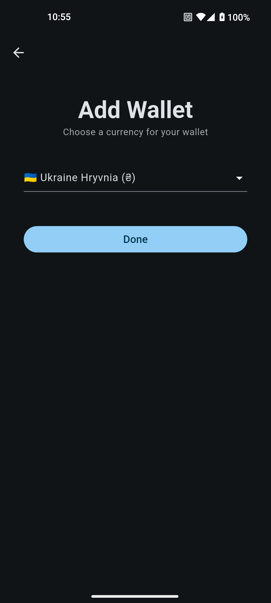
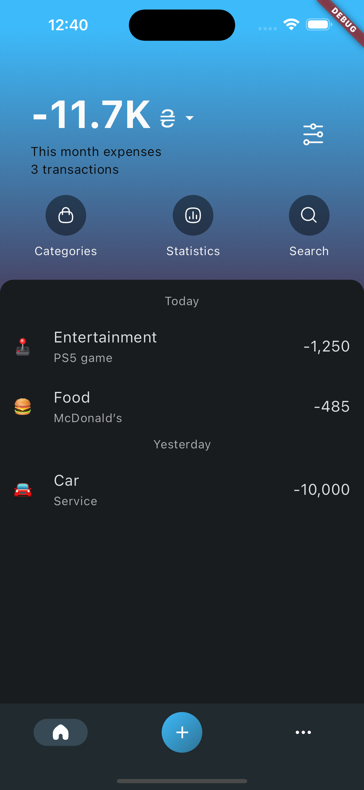
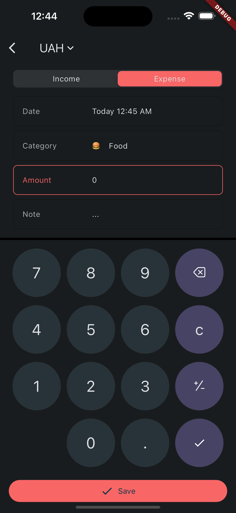
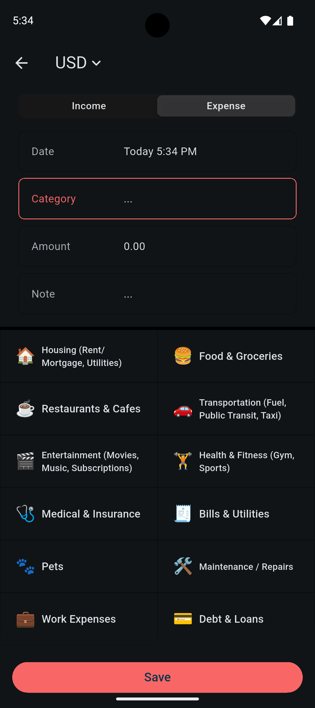
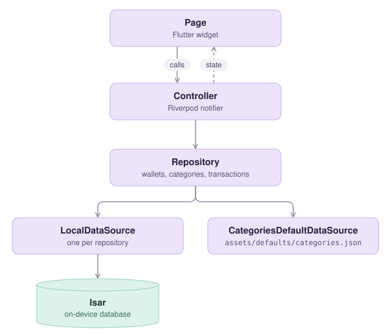

# Money Manager

An open-source personal finance tracker for Android and iOS, built with Flutter.

It works fully offline. There's no account and no server: your wallets, categories and transactions are stored only on your device.

## Features

- **Wallets.** Keep one wallet per currency and switch between them from the header.
- **Transactions.** Record income and expenses with a date, category, amount and note. The amount keypad has a built-in calculator.
- **Categories.** Comes with a default set. Pick an emoji for each category, drag to reorder, and archive the ones you no longer use.
- **Period totals.** See the total and transaction count for this day, week, month or year.
- **Statistics.** Monthly and annual charts with a breakdown by category.
- **Search.** Find transactions by note or amount.
- **Passcode.** Lock the app with a passcode, and optionally unlock it with biometrics.
- **Anonymous mode.** Pull down on the transactions list to hide every amount, for example when someone is looking at your screen.
- **Backup.** Export all your data to a JSON file and import it later or on another device. Importing replaces the current data.

## Screenshots

  
  
  
  

## Privacy

All data is stored locally in an [Isar](https://isar.dev) database. The app has no backend.

Prod builds send Firebase Analytics screen views and Sentry crash reports.

## Tech Stack

- [Flutter](https://flutter.dev)
- [Riverpod](https://riverpod.dev) for state management.
- [Isar](https://isar.dev) for local storage.
- [Freezed](https://github.com/rrousselGit/freezed) for domain models and UI state.
- [Equatable](https://github.com/felangel/equatable) for value equality on Isar entities.
- [Shared Preferences](https://github.com/flutter/packages/tree/main/packages/shared_preferences/shared_preferences) for settings and small bits of app state, like the current wallet and filters.
- [Flutter Secure Storage](https://pub.dev/packages/flutter_secure_storage) and [Local Auth](https://pub.dev/packages/local_auth) for the passcode and biometrics.
- [Syncfusion Flutter Charts](https://pub.dev/packages/syncfusion_flutter_charts) for statistics charts.

## Architecture

This is the main data path, simplified. It leaves out Shared Preferences and the services in `service/` and `feature/*/service/`. Only backup touches Isar outside the data sources: it reads and writes the database directly.
